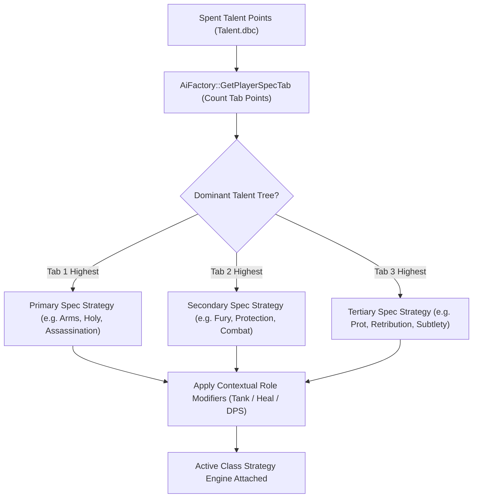

# Class AI & Roles Overview

TortoiseBots implements combat and utility AI for all nine Vanilla classes (Warrior through Druid). Bots detect their active talent spec dynamically, execute class-appropriate rotations, and support Turtle WoW 1.18.1 custom spells and talents.

## Supported Roles & Classes

| Class | Tank | Healer | Melee DPS | Ranged DPS | Crowd Control (CC) | Interrupts |
| :--- | :---: | :---: | :---: | :---: | :--- | :--- |
| **[Warrior](warrior.md)** | Prot | - | Arms, Fury | - | Intimidating Shout, Concussion Blow | Shield Bash, Pummel |
| **[Paladin](paladin.md)** | Prot | Holy | Retribution | - | Hammer of Justice, Repentance | Hammer of Justice, Repentance |
| **[Hunter](hunter.md)** | - | - | Survival (ranged-first hybrid) | BM, MM | Freezing Trap, Scare Beast | None (Scatter Shot snares) |
| **[Rogue](rogue.md)** | - | - | All Specs | - | Sap, Blind, Gouge | Kick |
| **[Priest](priest.md)** | - | Holy, Disc | - | Shadow | Shackle Undead, Psychic Scream, Chastise | Silence (Shadow) |
| **[Shaman](shaman.md)** | Tank (experimental) | Resto | Enhancement | Elemental | None | Earth Shock |
| **[Mage](mage.md)** | - | - | - | All Specs | Polymorph | Counterspell |
| **[Warlock](warlock.md)** | - | - | - | All Specs | Fear, Banish | Spell Lock (Felhunter) |
| **[Druid](druid.md)** | Bear | Resto | Cat | Balance | Entangling Roots, Hibernate | Bash |

---

## Spec Detection & Strategy Selection

The bot determines its combat strategy dynamically by inspecting spent talent points:

- **Dominant Talent Tree:** The bot tallies spent talent points across the three class tabs. Whichever tree has the highest allocation activates that combat strategy.
- **Hybrid Support:** Hybrid classes adapt forms and stances based on context and assigned group roles.
- **Battlegrounds:** Healing specs retain healing priorities in battlegrounds, layering battleground objectives and PvP strategies on top.
- **Dynamic Role Assignment:** In parties, players can set bot roles to adjust aggro generation, healing urgency, and positioning.

Players can use [`.bot role <Name|self>`](../play/commands/roster-and-hiring.md#bot-role) to override runtime role inference. Without an override, role detection uses party composition, stance or form, and tanking equipment (a shaman needs a shield, *Rockbiter Weapon* and *Totemic Alignment* or *Spirit Armor*; a bot that rolled the tank build counts as a tank from its talents alone — see [Shaman tank](shaman.md#class-settings)). If another tank already occupies the role, temporary stance or form changes do not promote a second tank.

---

## Shared Bot Behaviors

| Subsystem | Trigger Condition | Bot Action / Behavior | Configuration / Control |
| :--- | :--- | :--- | :--- |
| **Resting & Recovery** | Out-of-combat health or mana below recovery thresholds. | Sits down and consumes food and drink simultaneously. | See [Combat settings](../server/settings/combat.md). |
| **Buffs & Imbues** | Buff missing on self or party member. | Recasts class buffs, seals, auras, and weapon poisons. | Automatic out-of-combat maintenance. |
| **Targeting & Assist** | Tank or party leader engages hostile enemies. | Assists leader focus target and respects crowd control marks. | See [Focus skull](../play/commands/party-actions.md#bot-action-focus-skull). |
| **Finishing Runners** | Enemy mob flees below 30% health. | Ranged DPS finish within spell range; eligible melee close distance. | See detailed runner policy below. |
| **Threat Back-Off** | AoE threat at 50% of tank's threat, single-target threat at 80%. | Pauses high-threat single-target or AoE spells. | Controlled by `threat` strategy. |
| **Healer Off-DPS** | Party stable (no member below 90%) and mana >70–85% (95% in raids). | Contributes offensive spells and debuffs. | Controlled by `offdps` strategy. |
| **Spell Downranking** | Friendly target wounded but not in critical danger. | Casts lower-rank heals matching missing health. | Automatic triage optimization. |
| **Healer Positioning** | Party member out of heal range or line of sight. | Closes distance toward the tank or injured party member. | Automatic positioning routine. |
| **Looting & Gathering** | Corpse or nearby gathering node available. | Approaches corpse, loots quest items, and rolls on items. | See [Party actions](../play/commands/party-actions.md). |

Runner finishing, threat back-off, off-DPS, downranking, and healer positioning details

### Finishing Runners
When an enemy mob flees below 30% health (either flee state or flee-for-assistance):
- Ranged DPS finish the target within spell range.
- Warriors finish the runner if *Intercept* is available (in combat, Berserker Stance, rage available, off cooldown) within 25 yards.
- Other melee only attack runners already in melee reach.
- During `stay` holds, melee bots hold their position while ranged bots shoot within spell range.
- Healers and tanks do not chase runners.
- The active runner is never dropped for a fresh mob, and crowd-controlled targets are never chased.

### Party Threat Back-Off
In groups with the `threat` strategy active, damage dealers (including Druids, Hunters, Mages, Shamans, and Warlocks) monitor relative threat against the tank. When AoE threat reaches 50% of the tank's, or single-target threat reaches 80% (high threat), they pause high-threat single-target nukes or area-of-effect spells (*Volley*, *Multi-Shot*, *Blizzard*, *Flamestrike*, *Rain of Fire*, *Chain Lightning*, *Earthquake*) until threat stabilizes.

### Healer Off-DPS (`offdps`)
When the `offdps` strategy is enabled, healing bots contribute damage spells only when the group is safe:
- No member below 90%.
- The healer's own mana exceeds 85% in hard fights, or 70% in even or easy fights.
- Casting immediately yields to incoming damage when an ally needs healing.

### Spell Downranking
Healing bots automatically select the lowest spell rank that covers the target's missing health to conserve mana. Full spell ranks are enforced whenever a target falls into critical health (at or below 20% health).

### Healer Positioning
When a party member is out of heal range or line of sight:
- The healer moves toward that member. The default follow anchor is the tank when no member is injured.
- If another living healer already has that member in range and sight, the healer does not path to them unless the member is at or below critical health.
- Silenced, pacified, crowd-controlled, or out-of-mana healers do not satisfy the coverage check.
- Out of combat, healers only path to members below 90% health.

## Local companion behavior

## Shared party and raid healing

All healer classes use the same party-target selector across the full live raid roster, not only their subgroup. Candidates must be alive, friendly, in the same instance and inside the existing two-times-heal-range movement envelope. Dueling or teleporting players are excluded; pets receive the same validity checks. A focus-heal list stays exclusive and does not add selected NPCs or pets.

Selection uses the configured critical/low/medium/almost-full health bands rather than raw missing hit points. The most urgent player band wins; tanks receive a small preference within noncritical bands and win equal-health emergency ties. Critical allies take precedence over less urgent tanks. Pets are a fallback after injured players. Full-health tanks and healthy pets no longer fill assignment slots. The explicit `preheal` strategy still uses predicted melee damage.

Ready bot healers spread by stable GUID order only within the most urgent band. Dead, controlled, casting, distant, low-mana or explicitly focus-assigned peers do not consume automatic assignment slots. Routine targets already receiving a direct group heal are deferred; members below medium health remain eligible because a pending heal is not a survival guarantee. This is bounded roster-based triage, not an estimate of exact incoming healing or a persistent tank-healer reservation. Self-healing continues through existing self-health triggers.

### Saving mana when another heal lands first

The existing optional `heal interrupt` strategy now checks the native pre-cast state, so it can cancel a normal direct heal before mana is spent. Enable it in the reaction engine with `react +heal interrupt` (disable with `react -heal interrupt`). The patch does not enable it automatically or change mana-saving levels, trained ranks or class spell priorities.

It cancels a direct-only single-target heal when its actual cast target is full, or above 90% health with over half the estimated heal wasted. It does not cancel channels, area/chain heals or heal-plus-HoT spells based on one member's health. With the explicit `preheal` strategy, reachable melee attackers' estimated damage is included before deciding to cancel. This estimate does not predict boss spell damage; encounter testing remains necessary. Self-healing and party healing use the same guard when this optional strategy is active.

### Healing visibility and explicit assignments

Automatic triage prefers eligible allies currently in line of sight, then uses urgency bands and stable healer assignment within that visible set. A blocked ally does not displace a visible one merely because its health is lower. If no visible candidate exists, the normal reach prerequisite may approach an injured ally when movement is allowed. Explicit `focus heal targets` assignments may prioritize an urgent blocked target when the healer can move; stay, movement-control and current-cast gates prevent that exception. Within the same urgency band, visible assigned targets still win, including for additional healer slots. Normal path/cast validation remains authoritative; this does not guarantee a route around an obstacle.

Upstream healer coverage remains an eligibility filter in combat: a noncritical patient outside this healer’s range/LOS is left to another fit healer already covering that patient. Critical allies are never dropped by that filter. Hidden GMs remain excluded. Local urgency, assignments and LOS ordering apply to the remaining candidates.
