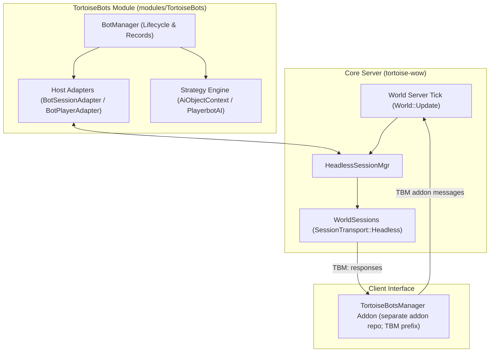

# Architecture Invariants & Core Boundaries

TortoiseBots adheres to strict architectural rules to prevent the severe code coupling that crippled earlier PlayerBots implementations.

## Architectural Boundaries

## The 5 Core Invariants

| Invariant | Architectural Principle | Violations to Prevent | Enforcement Mechanism |
| :--- | :--- | :--- | :--- |
| **1. 100% Modular Native C++** | Module lives entirely in `modules/TortoiseBots/`. | Direct core edits, mandatory module dependencies. | CMake `-DMODULES=disabled` build gate. |
| **2. Zero Core Coupling** | Core server contains zero bot AI or state. | `WorldSession::GetBot()`, `Player::m_bot`, `if (IsBot())`. | `tools/verify_penqle_host_contract.sh --core <path>` audit. |
| **3. Generic Headless Sessions** | Bots use standard `WorldSession` with `SessionTransport::Headless`. | Custom socket subclasses, bypassing network auth. | Headless checks, Human Reclaim protocol. |
| **4. Narrow Host Boundary** | All host interaction passes through explicit adapters in `host/`. | Direct header pollution, leaking module types into core. | `tools/verify_penqle_host_contract.sh`. |
| **5. Asynchronous LLM Isolation** | LLM/Chat reasoning is asynchronous from combat ticks. | Blocking the main world frame for network responses. | Per-message `std::async` + `DelayedBotPacket` deque drained on the world tick. |

---

## Detailed Invariant Specifications

### 1. 100% Modular Native C++ Module
The core server ([tortoise-wow](https://github.com/tortoise-wow/tortoise-wow)) must compile cleanly without TortoiseBots enabled (`-DMODULES=disabled`). TortoiseBots lives entirely inside `modules/TortoiseBots/`.

### 2. Zero Core Coupling (No `GetBot()` or `m_bot`)
Direct bot references are never introduced into core engine code:
* No `WorldSession::GetBot()` or `Player::m_bot`.
* No scattered `if (IsBot())` checks in core combat, movement, or spell systems.
* All bot state, AI decision engines, strategies, and inventories are owned exclusively by the `TortoiseBots` module.

### 3. Generic Headless Sessions (`SessionTransport::Headless`)
Bot sessions are not special core subclasses. They are standard `WorldSession` instances backed by `SessionTransport::Headless`:
* One Headless entry per character (duplicate starts for the same character are rejected); any number of headless character sessions per account — the headless side has no cap.
* **Human Reclaim Always Wins:** If a human logs into an account while a bot is active on the same character, the bot is cleanly logged out and human control takes precedence immediately.
* Headless sessions never manipulate `LoginDatabase` online account status, preserving normal network authentication boundaries.

### 4. Narrow, Centralized Host Boundary
All interaction between the module and core server passes through explicit adapters in `host/` (full boundary: [host-api.md](host-api.md)):
* `BotHostAdapter`: world-tick entry (`WorldScript` `OnUpdate`) driving `BotManager`/AI updates.
* `BotSessionAdapter`: Manages headless session allocation and termination via `World::StartHeadlessSession`.
* `BotPacketAdapter`: Handles packet routing and interception.
* `BotAddonAdapter`: addon-message entry (`PLAYERHOOK_ON_ADDON_MESSAGE`, `TBM` prefix) forwarding to the single `.bot` command entry.
* `BotChatAdapter`: chat-command entry (`AllCommandScript` for `.bot`); owns the drain of the queued player commands.
* `BotPlayerAdapter`: Interacts with standard `Player` objects through native server APIs; answers the core LFT managed-bot hooks (`IsManagedBot` gate + `GetBotRoles` role answer).

The world-tick entry returns before updating module services when
`AiPlayerbot.Enabled = 0` (also the default when no AI configuration is loaded).
This leaves disabled services inert, including periodic performance reporting
and stale-hire recovery. The AI enable flag is read at startup; changing it
requires a restart.

Within that world-tick pass, `BotManager::UpdateBots` schedules bots without any core involvement: bots under a real player update first and unbudgeted, while the random pool follows as a turn queue whose per-tick budget engages only while the previous world tick ran long. For scheduling details, see [Strategy Engine & Action Scheduling](strategy-engine.md).

Module and bot AI state is touched on the world thread only. A player's `.bot` or `TBM` command can arrive on a map or AsyncPackets thread, so the command adapters queue it (requester guid + text, never a pointer) and the world tick drains it before the bot update (every tick, also with the AI disabled); commands without an in-game player run inline (they are already on the world thread). See [host-api.md](host-api.md). The packet hooks follow the same rule: chat delivered to a bot is copied and handled by the world tick, and master -> bot lookups off the world thread read a guid view `BotManager` publishes under a lock once per tick instead of walking its records. A bot's AI is deleted on the world thread, and the AI storage lock covers only the lookup, so a packet hook off the world thread never keeps a `PlayerbotAI` or bot `Player` pointer: every packet an AI handles is copied, keyed by the bot's guid, and handed to the AI by the same world-tick drain, which resolves the guid again. Only a hook on the world thread itself, and the master's map-thread mimic summary (the world thread waits for map threads), use an AI directly. Commands, deferred chat and deferred packets share one sequence number stamped at enqueue, and the drain runs them merged by it, so a player's chat and `.bot` commands reach the bots in the order the module received them. To keep that world-thread drain cheap, each AI publishes the chat its first checks would drop (`runtime/BotChatGate.h`) and the hook does not copy those lines.

### 5. Asynchronous LLM Isolation
LLM-based chat interactions are purely asynchronous and decoupled. If an LLM backend times out or fails, combat AI, movement, healing, interrupts, and crowd control continue running with zero interruption or frame hitching.

---

## Related Player-Facing Boundaries

Player-facing boundaries, gameplay quirks, and project non-goals are cataloged in [Known Limitations & Quirks](../play/known-limitations.md). Key architectural invariants include:
- **Summon Sequencing:** Re-binding the master occurs before follow movement is resumed to guarantee ownership cannot be hijacked during a teleport transition.
- **Out-of-AH Inventory Queries:** Bots check their inventory values using cached vendor and pricing models rather than sending world-wide auction queries.

## Local companion behavior

### Experimental hire arrival

Experimental hire provisioning keeps initial-arrival gating inside the module; core teleport and instance admission remain authoritative. Existing companions are excluded once pending provisioning completes.

When the hiring player is already inside a raid map, initial hire arrival converts the shared party to a raid before teleporting. This uses normal core entry checks; it does not grant GM status or bypass instance restrictions. Arrival retry logging is bounded.

## Optional raid boss observations

`RaidBossDiagnostics` uses the existing unit-update and packet-send hooks to
record engaged raid bosses when explicitly enabled. The synchronous combat
opcode is observed on its owning map/world thread; asynchronous packet handling
remains deferred. No player, creature or AI pointer is retained. Per-instance
throttle metadata is mutex-protected, and threat lists are read only when a
snapshot is due. Health fields are samples/estimates, not post-damage guarantees.
See [the host contract](host-api.md#raid-boss-diagnostics-module-only).

## Policy headers by domain

Pure decision rules live in `*Policy.h` headers grouped by domain, so the
policy for a feature is found by folder instead of by guessing a file name:
`ai/playerbot/policy/<domain>/` for bot-AI rules (combat, pull, raid,
dungeon, travel, heal, loot, quest, gear, class, rpg) and
`runtime/policy/<domain>/` for lifecycle/service rules (pvp, hire, ah, pet,
class, provision, infra). Includes use paths relative to the existing
include roots (e.g. `playerbot/policy/travel/TravelRoutePolicy.h`), so no
new include directory is needed. Headers still referenced by an open
feature branch stay at their old flat path until that branch lands; the
flat names disappear once the last branch moves over.
