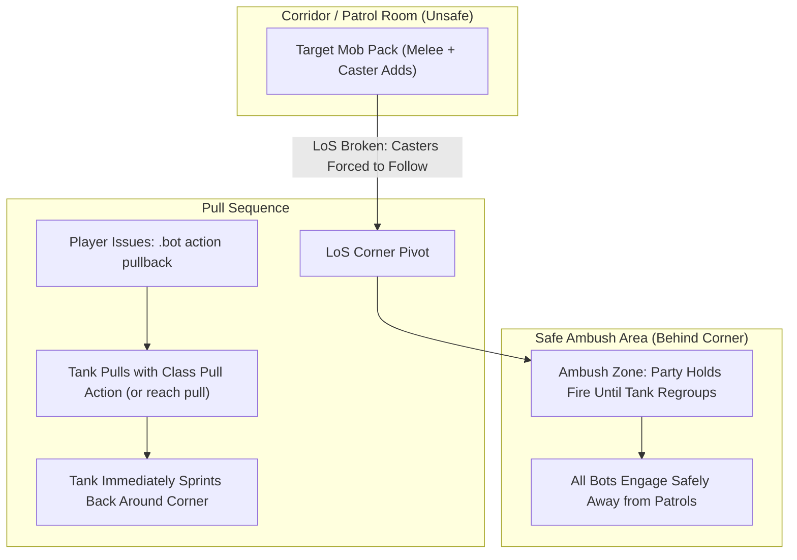

# Dungeon & Raid Tactics Guide

Running 5-player dungeons with companion bots is one of the most rewarding ways to experience Vanilla and Turtle WoW. However, dungeon mobs hit hard, patrol packs add unexpectedly, and casters flee into adjacent rooms. 

This guide outlines practical field tactics to ensure smooth dungeon runs without unnecessary wipes.

---

## 1. The Five Golden Rules of Bot Dungeoneering

1. **Pull to LoS Corners, Don't Charge:** Use `.bot action pullback` so the tank pulls and runs back to you around a corner. Never let bots fight out in open corridors where patrols roam.
2. **Toggle AoE OFF on CC Packs:** Before pulling packs where you plan to *Polymorph* or *Sap*, run `.bot action aoe off`. This prevents Mages (*Blizzard*), Warlocks (*Rain of Fire*), and Hunters (*Multi-Shot*) from accidentally breaking crowd control.
3. **Always Mark the Primary Target with Skull:** Issue `.bot action focus skull`. DPS treat the Skull-marked target as their kill priority (it sets the mark and issues one attack; normal target selection — peels, CC protection, re-targeting — still applies).
4. **Give the Tank Two Seconds:** Tanks tab-target *Sunder Armor* (warlock pets add *Torment*) based on lowest personal threat. Give them 2–3 seconds to establish initial aggro before nuking.
5. **Keep `.bot summon <Name>` Ready:** If a bot gets stuck on tricky instance terrain (like Blackrock Depths stairs or Gnomeregan elevators), `.bot summon <Name>` snaps them directly to you out of combat.

---

## 2. Pulling Mechanics & Line-of-Sight (LoS)

Open corridors are death traps in dungeons like Deadmines, Scarlet Monastery, and Stratholme. Casters stand at 30 yards casting fireballs while melee mobs surround your healer.

### The Pullback Maneuver (`.bot action pullback`)
When you target an enemy mob and issue `.bot action pullback`:
1. The server picks the puller by precedence: your targeted bot, else any bot designated `.bot role <Name> tank` (any class), else a native tank-spec bot.
2. The tank uses its class pull action (ranged shot/throw, *Judgement*, *Faerie Fire*, *Serpent Sting*, or *Lightning Bolt*) — or closes in and body-pulls (`reach pull`) when no ranged option exists — applies immediate threat, and immediately sprints back to your party's current location, where it takes the incoming mobs over on its own (no follow-up order needed). A ranged pull walks to a firing position with a point move first: the core's chase generator refuses a destination that is not melee-reachable from the target inside a dungeon, so the old chase left the tank standing at the pull spot until the pull timed out. The firing point is used only when it is reachable, on the tank's own floor and in sight of the mob; around a corner or over a ledge the tank advances towards the mob until it can shoot.
3. Non-tank bots hold fire until the tank reaches the regroup anchor, drawing the entire mob pack safely around the corner into your ambush.
4. The tank holds the anchor only for the fight that pull brought in: as soon as it is over (mob dead, nothing left to tank, out of combat) the hold is released and the tank follows the party again. A stay you place yourself is not part of that hold — any movement order (`.bot action stay`, `.bot action follow`, …) takes the hold over, and the release leaves your stay alone. `.bot action pull` / `pullback` is also the only thing that starts a pull, and it is what names the anchor the party waits at.
5. **A pull that draws no aggro ends as a failed pull.** If the shot is blocked, the mob evades, or nothing arrives within the 15 s pull window, the tank drops the target, leaves combat, and follows the party again instead of standing in a fight that never started; the waiting DPS are released at that moment rather than serving out their join window. There is nothing to tank, so there is no anchor to hold.



---

## 3. Crowd Control (CC) Protocol

Crowd control is essential for multi-caster pulls in level 40+ dungeons.

### Suggested Raid Target Icon Assignments

Every bot starts with **Moon** as its CC mark, whatever its class. The table below is a convention for the player, not something the bots follow on their own: a Star on an undead gets no *Shackle Undead* until a priest bot owns Star. Give each CC bot its mark once with `.bot action cc <mark> [bot]` (see [Issuing CC In-Game](#issuing-cc-in-game)); the assignment is saved and survives relog. Check a bot's current mark by whispering it `rti`.

| Raid Icon | Primary Class & Ability | Valid Targets | Notes |
| :---: | :--- | :--- | :--- |
| **Moon** | **Mage** (*Polymorph*) / **Rogue** (*Sap*) | Beasts, Humanoids | Humanoids only for Sap. The rogue stealths, sneaks up and Saps its mark on its own while nobody is in combat; wait for the Sap before you pull. |
| **Star** | **Priest** (*Shackle Undead*) / **Paladin** (*Turn Undead*) | Undead only | Crucial in Stratholme, Scholomance, and Shadowfang Keep. |
| **Diamond** | **Warlock** (*Banish* / *Fear*) | Demons, Elementals (Banish); Fear only on its assigned mark | Banish completely immunizes target from damage. *Seduce* is not a bot CC executor. |
| **Triangle** | **Hunter** (*Freezing Trap* / *Scare Beast*) / **Druid** (*Hibernate* / *Entangling Roots*) | Beasts, Dragonkin | Hunter drops trap; tank guides mob over the trap. |

### Issuing CC In-Game
* Target the mob you want CC'd and type:
  ```text
  .bot action cc moon
  ```
* Until you assign marks, every bot holds **Moon**: any bot whose CC fits the Moon mob may take it, and nobody CCs a Star, Diamond or Triangle. To assign a mark before the pull without selecting a mob, name the bot (`.bot action cc star <PriestName>`) or target the bot.
* The mark is assigned to exactly one bot (exclusive ownership); reassigning it moves ownership. When no owned bot is targeted, the server selects the capable bot with the best-fitting CC for that target (Sap before the pull, then Shackle/Banish/Hibernate/Polymorph/traps, Fear last); the same target and state always pick the same bot.
* Targeting an enemy when you type the command puts that mark on your current target (moving it off any mob that carried it). Select the bot instead, or clear your target, to keep the mark where you placed it.
* **Rogue Sap before the pull:** out of combat a rogue (with you as its master) stealths and Saps the humanoid carrying its mark, so mark first, wait for the Sap, then pull. Nothing waits for the Sap automatically. On by default; `.bot action sap off [bot]` stops it.
* Dismiss with `.bot action cc clear` (targeted bot, or the whole owned party when untargeted).
* **Dungeon rule:** inside non-raid dungeons bots CC only their assigned mark; in the open world they may CC a free pick, never one a group member or pet is attacking or targeting. Bots never CC over an existing CC, and AoE triggers refuse packs holding a breakable CC.
* **Automatic Discipline:** Once applied, party bots and pets are strictly blocked from attacking the crowd-controlled target until all other active threats are dead. Then the marked mob is killed last: when only CC-marked mobs are left fighting the group (sheeped, or free because the CC never landed), the tank and DPS pick one up, and the CC bot stops re-CCing. A stunned, rooted, feared or otherwise held unmarked mob still counts as an enemy left, and a marked mob that is not in combat yet (an unpulled pack) is never picked. "Only marks left" needs at least one live enemy in the group's attackers list: an empty list (nothing fighting yet, or the list not refreshed) does not count, so it never stops the CC bot from sheeping its mark. A mark that is the only enemy left is killed, not sheeped, once the group's attackers list has it (up to about 1 s after the pull; in that first second the CC bot may still start one CC cast on it).
* **Only a held mark is off-limits:** the mark is protected while it is crowd-controlled (sheeped, sapped, shackled, hibernated, trapped, banished, feared, seduced), while a group member's CC cast bar is on it, and for the first 10 s of its fight while its CC bot (the bot whose `rti cc` points at it, `cc` strategy on) knows a fitting CC spell, has it ready and is within spell range (+5 yd). A pack mob's fight starts when the first mob of the pack is pulled, so the window also covers a CC bot that is still finishing its opener. A mark that is free (nobody can CC it, or the CC missed or broke and the 10 s are over) is a normal enemy: the tank taunts and picks it up, DPS attack it and it does not block area spells. Once it is crowd-controlled again the rules below apply again.
* **Hands off the held mark:** while any other enemy still fights the group, a bot whose current target is a held CC mark drops it (unless the player ordered the attack on it, or the bot is casting the CC); the tank's *Taunt* on a mob chasing a healer (one exception below), DoT spreading (*Shadow Word: Pain* on attackers) and interrupts on an enemy healer (*Kick*, *Shield Bash*, *Pummel*, *Counterspell*, ... on a Moon mob casting a heal) skip it. Every enemy-area spell, instant, chained or lingering, whose blast would reach a sheeped/sapped mob or a held mark (under the CC cast bar or in its hold window) is skipped (radius and centre from the spell data: *Frost Nova*, *Cone of Cold*, *Thunder Clap*, *Cleave*, *Multi-Shot*, *Flamestrike*, *Blizzard*, ...). The CC bot itself never hits its own mark with an area spell while other enemies are left, held or free, because it sheeps that mob next. One exception passes the hold: when a held mark that is not sheeped yet (and has no CC cast bar on it) hits a healer, the tank *Taunts* it. Taunt does no damage, and the tank keeps its own target. The CC bot starts its CC cast only in line of sight and 5 yd inside the spell's range (it walks closer first; under `stay` it starts none at 25-30 yd). With `AiPlayerbot.EnableActionLog = 1`, failed CC casts are written to the bot action log (`CC_CAST_FAILED`). No bot starts *Oil of Immolation* within 8 yd of a sheeped mob or a held mark, and the rogue does not start *Blade Flurry* within 11 yd of one; *Blade Flurry* is a toggle on Turtle (no duration, 4 s cooldown) that stays on from the last pull, so a running one is cancelled while a sheeped mob, a held mark or a CC mark whose CC bot is ready to sheep it (even after the 10 s) is within 8 yd: its swings copy onto any enemy within 5 yd other than the rogue's own target. It is not turned back on while one is within 11 yd. The rogue's own target is ignored for the crowd-control test (its own *Gouge* does not cancel Blade Flurry), but a ready mark counts even when it is the rogue's target. DoTs already on the mob before you marked it can still break the first sheep.

---

## 4. Wipe Recovery & Instance Navigation

If your group wipes, follow this checklist to recover quickly:

### Releasing Spirit & Corpse Runs
1. When dead, whisper your bots `/w <BotName> release` (or type `.bot command <Name> release`).
2. Once in ghost form at the graveyard, issue `/w <BotName> corpse run`.
3. Ghost bots will path organically back to the instance portal and zone inside.
4. If a bot gets stuck outside the dungeon entrance, simply zone in yourself and type `.bot summon <Name>` to gather them safely at the instance threshold.

### Healers and Casters Closing Range
* Inside an instance, a healer or caster that sees its target but stands out of range walks the navmesh path towards it and stops at the first point within casting distance that still has line of sight. It used the core's chase before, which inside dungeons refuses any destination outside melee reach, so the healer stood still at the entrance while the tank fought 38 yd away.
* When the navmesh only reaches part of the way (a raised dais, a ledge), the bot walks to the closest point on the path that still sees its target and stops there; it does not drop off ledges. Use `.bot summon <Name>` out of combat if it stays stuck.

### Elevators, Boats & Ledges
* In complex vertical dungeons (Gnomeregan, Sunken Temple, Blackrock Spire), bots can occasionally desync when jumping down ledges or riding elevators.
* Always wait for bots at the bottom of elevators or after ledge drops, then click **Summon** in `/tbm` to regroup before engaging the next pack.

---

## 6. Raid Survival (MC / Onyxia / BWL / Naxx)

Entering a raid map auto-enables the `dungeon` transition engine, which swaps in the matching raid tactics (`molten core`, `onyxia's lair`, `blackwing lair`, `naxxramas`, `zul'gurub`, `ruins of ahn'qiraj`, `ahn'qiraj temple`) and tears them down on exit. Per-boss fight scripts can look up bosses by name (`find target` / `boss target`) and suppress threat gating (`neglect threat`) while scripted positioning owns target choice. Four universal behaviors run on the reaction engine in any raid:
Entering a raid map auto-enables the `dungeon` transition engine, which swaps in the matching raid tactics (`molten core`, `onyxia's lair`, `blackwing lair`, `naxxramas`, `ruins of ahn'qiraj`) and tears them down on exit. Four universal behaviors run on the reaction engine in any raid:

- **Bomb runout:** carriers of *Living Bomb* (Geddon), *Burning Adrenaline* (Vaelastrasz), or *Mutating Injection* (Grobbulus), or *Detonate Mana* (Kel'Thuzad) run 30yd clear of the raid: they move once, straight away from the centre of the living raid members, and stop as soon as no one is within that distance (`AiPlayerbot.BombRunoutDistance`).
- **Bomb runout:** carriers of *Living Bomb* (Geddon), *Burning Adrenaline* (Vaelastrasz), or *Mutating Injection* (Grobbulus, ranged carriers go behind the boss) run 30yd clear of the raid: they move once, straight away from the centre of the living raid members, and stop as soon as no one is within that distance (`AiPlayerbot.BombRunoutDistance`).
- **Bomb runout:** carriers of *Living Bomb* (Geddon), *Burning Adrenaline* (Vaelastrasz), or *Mutating Injection* (Grobbulus) run 30yd clear of the raid: they move once, straight away from the centre of the living raid members, and stop as soon as no one is within that distance (`AiPlayerbot.BombRunoutDistance`).
- **Living Bomb spacing (Geddon):** while the `geddon` fight runs, anyone standing within 10yd of a *Living Bomb* (20475) carrier steps out of the blast (`move away from living bomb`); the carrier itself still runs 30yd clear via bomb runout.
- **Hazard evasion:** lava bombs, void zones, and poison clouds trigger the shared hazard move-away as a reactive step-out (no persistent path avoidance yet).
- **Bomb runout:** carriers of *Living Bomb* (Geddon), *Burning Adrenaline* (Vaelastrasz), or *Mutating Injection* (Grobbulus) run 30yd clear of the raid: they move once, straight away from the centre of the living raid members, and stop as soon as no one is within that distance (`AiPlayerbot.BombRunoutDistance`).
- **Hazard evasion:** void zones step out proactively before the debuff lands: dynobj auras, damaging trap GOs, and trigger NPCs inside 15yd strafe to safety while staying in combat range (melee strafes off the target, ranged stays in the cast band), with the flee-heading memory vetoing failed directions. Once the debuff actually lands, the reactive flee runs out instead. Lava bombs and poison clouds still trigger the shared hazard move-away as well.
- **Dragon geometry:** non-tanks flank out of breath/tail cones automatically; order tanks with `.bot action raid tankface` to drag the head away from the raid.
- **Tank jobs:** boss scripts that split tanks (Golemagg, Razorgore) and the `main tank` target (Fear Ward, Thorns) share one order over living tanks on the same map. Main tank: the group's stored Main Tank, else its Main Assist if that is a tank, else the first tank in join (slot) order. Assist tanks: the Main Assist tank, then tanks promoted to raid assistant, then the rest in slot order. The 1.12 client has no Main Tank / Main Assist buttons, so in game the lever is **Promote to Assistant**: a promoted tank takes the first assist job (Razorgore boss hold, a Golemagg rager camp).
- **Ranged spread:** stacked casters split 12yd apart (`AiPlayerbot.HazardEvasionDistance`). Pool bots (no real player master) also spread in any group combat — not just raids — when a friendly stands within 10yd. Owned/hired bots under a player master spread only on raid maps (including the Onyxia phase-2 spread); in the open world and in 5-man dungeons they stay on their player. Explicit hold orders (`stay`, `guard`, `wait for attack`) are exempt everywhere. Opt in wider with `.bot behavior party spread on`: owned/hired bots and melee spread too — tanks excluded — stepping just past the trigger radius (5yd ranged / 2yd melee by default; whisper a bot `spread distance <yards>` to set, `spread distance off` to reset).
- **Dispel spread:** decursers and dispellers each claim the member they pick, so the next bot of the same dispel type takes another member (Lucifron, Gehennas and Chromaggus curses are cleared in parallel). They stay on their spot: only members in line of sight and within about 1.5 x spell range (39yd) are considered, in-range ones first.
- **Spread memory:** a bot that spreads remembers its last two step-out headings and picks a different vector next time (within ~45 degrees is skipped). Ordinary flees do not use this veto: kiting casters need to keep stepping straight away from the mob.
- **Protection potions:** once a listed boss is in the fight, a level 48+ bot drinks the matching Greater Protection Potion if it carries one (or runs with the item cheat) and the buff is not up: fire for Magmadar, Baron Geddon, Golemagg, Ragnaros, Onyxia, Razorgore and Vaelastrasz; shadow for Lucifron, Gehennas and Nefarian; nature for Princess Huhuran and Viscidus. It never drinks between trash pulls, and in combat the potion ranks below movement, dispels and every heal but above the damage rotation, so it goes down early in the pull. Bosses with mixed schools (Garr, the BWL drakes, Chromaggus, Hakkar) get none.

Encounter notes: MC runes douse via `.bot action raid douse` (Eternal Quintessence 22754 first, Aqual 17333 fallback); Onyxia phase 2 swaps bots to `shoot` + spread while airborne; BWL rogues disarm suppression devices (wired in both combat and non-combat states); 4H mark carriers (3+ stacks of one mark) move to the next horseman's corner clockwise, fewest stacks first (tanks and DPS take that horseman, healers stand 20yd off it toward the room; each keeps that corner until the mark it left drops, and `stay` holds it in place; the rotation outranks skull/RTI marks for the carrier, and a tank bot only leaves a corner another tank already covers); Gluth off-tanks taunt at 5 Mortal Wounds while DPS executes sub-10% chow (kite ring and decimate spots need live coords).
Encounter notes: Golemagg splits tanks to fixed camps (main holds the boss, assists hold a rager each, 30yd Trust separation), melee back off at 20 Magma Splash stacks until it expires, healers work the camp midpoint, and DPS leave ragers alone while Golemagg lives (burn below 10%); MC runes douse via `.bot action raid douse` (Eternal Quintessence 22754 first, Aqual 17333 fallback); Onyxia phase 2 swaps bots to `shoot` + spread while airborne; BWL rogues disarm suppression devices (wired in both combat and non-combat states); 4H mark carriers (3+ stacks of one mark) move to the next horseman's corner clockwise, fewest stacks first (tanks and DPS take that horseman, healers stand 20yd off it toward the room; each keeps that corner until the mark it left drops, and `stay` holds it in place; the rotation outranks skull/RTI marks for the carrier, and a tank bot only leaves a corner another tank already covers).
Encounter notes: MC runes douse via `.bot action raid douse` (Eternal Quintessence 22754 first, Aqual 17333 fallback); Onyxia phase 2 swaps bots to `shoot` + spread while airborne; BWL rogues disarm suppression devices (wired in both combat and non-combat states); 4H mark carriers (3+ stacks of one mark) move to the next horseman's corner clockwise, fewest stacks first (tanks and DPS take that horseman, healers stand 20yd off it toward the room; each keeps that corner until the mark it left drops, and `stay` holds it in place; the rotation outranks skull/RTI marks for the carrier, and a tank bot only leaves a corner another tank already covers); Thaddius splits pets Stalagg/Feugen evenly (assists suppressed for the pet targeting, DPS holds at 40% on a trailing pet), drops via the edge low spots at the transition, then takes polarity sides at lethal priority (negative left, positive right; overrides stay — the 30s shift window is unsurvivable parked).
Encounter notes: MC runes douse via `.bot action raid douse` (Eternal Quintessence 22754 first, Aqual 17333 fallback); Onyxia phase 2 swaps bots to `shoot` + spread while airborne; BWL rogues disarm suppression devices (wired in both combat and non-combat states); 4H mark carriers (3+ stacks of one mark) move to the next horseman's corner clockwise, fewest stacks first (tanks and DPS take that horseman, healers stand 20yd off it toward the room; each keeps that corner until the mark it left drops, and `stay` holds it in place; the rotation outranks skull/RTI marks for the carrier, and a tank bot only leaves a corner another tank already covers); Kel'Thuzad phase 1 burns adds by role around the center, phase 2 rings ranged at 20/32yd with lethal-priority fissure flee, tanks split MT/guardian anchors, assists suppressed for the chooser (Detonate Mana runs out via bomb runout).
Encounter notes: MC runes douse via `.bot action raid douse` (Eternal Quintessence 22754 first, Aqual 17333 fallback); Onyxia phase 2 swaps bots to `shoot` + spread while airborne, and Deep Breath casts send bots to the nearest breath-lane safe zone; BWL rogues disarm suppression devices (wired in both combat and non-combat states); 4H mark carriers (3+ stacks of one mark) move to the next horseman's corner clockwise, fewest stacks first (tanks and DPS take that horseman, healers stand 20yd off it toward the room; each keeps that corner until the mark it left drops, and `stay` holds it in place; the rotation outranks skull/RTI marks for the carrier, and a tank bot only leaves a corner another tank already covers).
Encounter notes: MC runes douse via `.bot action raid douse` (Eternal Quintessence 22754 first, Aqual 17333 fallback); Onyxia phase 2 swaps bots to `shoot` + spread while airborne; Garr holds DPS AoE off (Firesworn die single-target) and Shazzrah pushes ranged out to 26yd; BWL rogues disarm suppression devices (wired in both combat and non-combat states); 4H mark carriers (3+ stacks of one mark) move to the next horseman's corner clockwise, fewest stacks first (tanks and DPS take that horseman, healers stand 20yd off it toward the room; each keeps that corner until the mark it left drops, and `stay` holds it in place; the rotation outranks skull/RTI marks for the carrier, and a tank bot only leaves a corner another tank already covers).
Encounter notes: MC runes douse via `.bot action raid douse` (Eternal Quintessence 22754 first, Aqual 17333 fallback); Onyxia phase 2 swaps bots to `shoot` + spread while airborne; BWL rogues disarm suppression devices (wired in both combat and non-combat states); Razorgore non-victims clear the 15yd frontal cone (ranged hold 15yd for War Stomp), the first tank holds the boss while eggs live, and the orb stays a player job; 4H mark carriers (3+ stacks of one mark) move to the next horseman's corner clockwise, fewest stacks first (tanks and DPS take that horseman, healers stand 20yd off it toward the room; each keeps that corner until the mark it left drops, and `stay` holds it in place; the rotation outranks skull/RTI marks for the carrier, and a tank bot only leaves a corner another tank already covers).
Encounter notes: MC runes douse via `.bot action raid douse` (Eternal Quintessence 22754 first, Aqual 17333 fallback); Onyxia phase 2 swaps bots to `shoot` + spread while airborne; BWL rogues disarm suppression devices (wired in both combat and non-combat states); 4H mark carriers (3+ stacks of one mark) move to the next horseman's corner clockwise, fewest stacks first (tanks and DPS take that horseman, healers stand 20yd off it toward the room; each keeps that corner until the mark it left drops, and `stay` holds it in place; the rotation outranks skull/RTI marks for the carrier, and a tank bot only leaves a corner another tank already covers); Loatheb bots kill spores underfoot for Fungal Bloom and hold tank/ranged spots (no Doom-window healing design yet — vanilla has no Necrotic Aura).
Encounter notes: the first paladin bot in the raid auto-swaps to Fire or Shadow Resistance Aura per boss (any manual `aura ...` order wins); MC runes douse via `.bot action raid douse` (Eternal Quintessence 22754 first, Aqual 17333 fallback); Onyxia phase 2 swaps bots to `shoot` + spread while airborne; BWL rogues disarm suppression devices (wired in both combat and non-combat states); 4H mark carriers (3+ stacks of one mark) move to the next horseman's corner clockwise, fewest stacks first (tanks and DPS take that horseman, healers stand 20yd off it toward the room; each keeps that corner until the mark it left drops, and `stay` holds it in place; the rotation outranks skull/RTI marks for the carrier, and a tank bot only leaves a corner another tank already covers).
Encounter notes: MC runes douse via `.bot action raid douse` (Eternal Quintessence 22754 first, Aqual 17333 fallback); Onyxia phase 2 swaps bots to `shoot` + spread while airborne; BWL rogues disarm suppression devices (wired in both combat and non-combat states); bots carrying Hourglass Sand (19183) cleanse Chromaggus Bronze affliction with it; 4H mark carriers (3+ stacks of one mark) move to the next horseman's corner clockwise, fewest stacks first (tanks and DPS take that horseman, healers stand 20yd off it toward the room; each keeps that corner until the mark it left drops, and `stay` holds it in place; the rotation outranks skull/RTI marks for the carrier, and a tank bot only leaves a corner another tank already covers).
Encounter notes: MC runes douse via `.bot action raid douse` (Eternal Quintessence 22754 first, Aqual 17333 fallback); Onyxia phase 2 swaps bots to `shoot` + spread while airborne; BWL rogues disarm suppression devices (wired in both combat and non-combat states); Broodlord pushes ranged non-victims out to 18yd, drake off-tanks flank the breath cone, Vaelastrasz joins the dragon-flank list, and mages Ice Block Nefarian Wild Magic; 4H mark carriers (3+ stacks of one mark) move to the next horseman's corner clockwise, fewest stacks first (tanks and DPS take that horseman, healers stand 20yd off it toward the room; each keeps that corner until the mark it left drops, and `stay` holds it in place; the rotation outranks skull/RTI marks for the carrier, and a tank bot only leaves a corner another tank already covers).
Encounter notes: MC runes douse via `.bot action raid douse` (Eternal Quintessence 22754 first, Aqual 17333 fallback); Onyxia phase 2 swaps bots to `shoot` + spread while airborne; BWL rogues disarm suppression devices (wired in both combat and non-combat states); Vaelastrasz Burning Adrenaline carriers flee from clean bots (victims cluster, the tank holds), with tail-sweep recovery and ranged cast-range bias; 4H mark carriers (3+ stacks of one mark) move to the next horseman's corner clockwise, fewest stacks first (tanks and DPS take that horseman, healers stand 20yd off it toward the room; each keeps that corner until the mark it left drops, and `stay` holds it in place; the rotation outranks skull/RTI marks for the carrier, and a tank bot only leaves a corner another tank already covers).
Encounter notes: MC runes douse via `.bot action raid douse` (Eternal Quintessence 22754 first, Aqual 17333 fallback); Onyxia phase 2 swaps bots to `shoot` + spread while airborne; BWL rogues disarm suppression devices (wired in both combat and non-combat states); 4H mark carriers (3+ stacks of one mark) move to the next horseman's corner clockwise, fewest stacks first (tanks and DPS take that horseman, healers stand 20yd off it toward the room; each keeps that corner until the mark it left drops, and `stay` holds it in place; the rotation outranks skull/RTI marks for the carrier, and a tank bot only leaves a corner another tank already covers); Sapphiron air phase hides behind iceblocked players (lethal priority, above heals) and blizzards are stepped out of; ground positioning is unchanged (no flank: rear is the tail cone).
Encounter notes: MC runes douse via `.bot action raid douse` (Eternal Quintessence 22754 first, Aqual 17333 fallback); Baron Geddon's *Inferno* sends every bot 20yd out (casts stop, other movement waits) while it burns; Onyxia phase 2 swaps bots to `shoot` + spread while airborne; BWL rogues disarm suppression devices (wired in both combat and non-combat states); 4H mark carriers (3+ stacks of one mark) move to the next horseman's corner clockwise, fewest stacks first (tanks and DPS take that horseman, healers stand 20yd off it toward the room; each keeps that corner until the mark it left drops, and `stay` holds it in place; the rotation outranks skull/RTI marks for the carrier, and a tank bot only leaves a corner another tank already covers).
Encounter notes: MC runes douse via `.bot action raid douse` (Eternal Quintessence 22754 first, Aqual 17333 fallback); Onyxia phase 2 swaps bots to `shoot` + spread while airborne; BWL rogues disarm suppression devices (wired in both combat and non-combat states); 4H mark carriers (3+ stacks of one mark) move to the next horseman's corner clockwise, fewest stacks first (tanks and DPS take that horseman, healers stand 20yd off it toward the room; each keeps that corner until the mark it left drops, and `stay` holds it in place; the rotation outranks skull/RTI marks for the carrier, and a tank bot only leaves a corner another tank already covers); Heigan ranged hold his platform in phase 1 (unless parked by explicit orders) and everyone dances floor sections 0-1-2-3-2-1 on Plague Cloud — dance moves run at lethal priority with other movement suppressed, timed casts excepted. Fight-phase eruptions every 10s have no safe call yet (slow-phase dancing is a disclosed gap).
Encounter notes: MC runes douse via `.bot action raid douse` (Eternal Quintessence 22754 first, Aqual 17333 fallback); Onyxia phase 2 swaps bots to `shoot` + spread while airborne; BWL rogues disarm suppression devices (wired in both combat and non-combat states); 4H mark carriers (3+ stacks of one mark) move to the next horseman's corner clockwise, fewest stacks first (tanks and DPS take that horseman, healers stand 20yd off it toward the room; each keeps that corner until the mark it left drops, and `stay` holds it in place; the rotation outranks skull/RTI marks for the carrier, and a tank bot only leaves a corner another tank already covers); Anub'Rekhan non-tanks burn guards first and collapse center on Locust Swarm (tank kite ring needs live waypoints).
Encounter notes: the first paladin bot in the raid auto-swaps to Fire or Shadow Resistance Aura per boss (any manual `aura ...` order wins); MC runes douse via `.bot action raid douse` (Eternal Quintessence 22754 first, Aqual 17333 fallback); Onyxia phase 2 swaps bots to `shoot` + spread while airborne; BWL rogues disarm suppression devices (wired in both combat and non-combat states); Broodlord pushes ranged non-victims out to 18yd, drake off-tanks flank the breath cone, Vaelastrasz joins the dragon-flank list, and mages Ice Block Nefarian Wild Magic; Vaelastrasz Burning Adrenaline carriers flee from clean bots (victims cluster, the tank holds), with tail-sweep recovery and ranged cast-range bias; Baron Geddon's *Inferno* sends every bot 20yd out (casts stop, other movement waits) while it burns; 4H mark carriers (3+ stacks of one mark) move to the next horseman's corner clockwise, fewest stacks first (tanks and DPS take that horseman, healers stand 20yd off it toward the room; each keeps that corner until the mark it left drops, and `stay` holds it in place; the rotation outranks skull/RTI marks for the carrier, and a tank bot only leaves a corner another tank already covers); Sapphiron air phase hides behind iceblocked players (lethal priority, above heals) and blizzards are stepped out of; ground positioning is unchanged (no flank: rear is the tail cone); Heigan ranged hold his platform in phase 1 (unless parked by explicit orders) and everyone dances floor sections 0-1-2-3-2-1 on Plague Cloud — dance moves run at lethal priority with other movement suppressed, timed casts excepted; Anub'Rekhan non-tanks burn guards first and collapse center on Locust Swarm (tank kite ring needs live waypoints).
Encounter notes: AQ20 Ossirian runners head for the nearest crystal while his *Strength of Ossirian* (25176) buff is up (or the weakness is nearly out), wait in range, and use the crystal while he is within 25yd (kiting Ossirian to a crystal stays the raid's job — no bot kite tactic, same gap as the donor); other AQ20 bosses have no scripted tactics yet. MC runes douse via `.bot action raid douse` (Eternal Quintessence 22754 first, Aqual 17333 fallback); Onyxia phase 2 swaps bots to `shoot` + spread while airborne; BWL rogues disarm suppression devices (wired in both combat and non-combat states); 4H mark carriers (3+ stacks of one mark) move to the next horseman's corner clockwise, fewest stacks first (tanks and DPS take that horseman, healers stand 20yd off it toward the room; each keeps that corner until the mark it left drops, and `stay` holds it in place; the rotation outranks skull/RTI marks for the carrier, and a tank bot only leaves a corner another tank already covers).
Encounter notes: MC runes douse via `.bot action raid douse` (Eternal Quintessence 22754 first, Aqual 17333 fallback); Onyxia phase 2 swaps bots to `shoot` + spread while airborne; BWL rogues disarm suppression devices (wired in both combat and non-combat states); on entering Blackwing Lair (map 469) each bot without the Onyxia Scale Cloak (15138, equip spell 22683, Shadow Flame immunity for Firemaw/Ebonroc/Flamegor/Nefarian) whispers its master once - warning only, no aura is granted; 4H mark carriers (3+ stacks of one mark) move to the next horseman's corner clockwise, fewest stacks first (tanks and DPS take that horseman, healers stand 20yd off it toward the room; each keeps that corner until the mark it left drops, and `stay` holds it in place; the rotation outranks skull/RTI marks for the carrier, and a tank bot only leaves a corner another tank already covers); Gluth off-tanks taunt at 5 Mortal Wounds while DPS executes sub-10% chow (kite ring and decimate spots need live coords).
Encounter notes: Golemagg splits tanks to fixed camps (the main tank holds the boss, assist tanks hold a rager each, 30yd Trust separation), melee back off at 20 Magma Splash stacks until it expires, healers work the camp midpoint, and DPS leave ragers alone while Golemagg lives (burn below 10%); MC runes douse via `.bot action raid douse` (Eternal Quintessence 22754 first, Aqual 17333 fallback); Onyxia phase 2 swaps bots to `shoot` + spread while airborne; BWL rogues disarm suppression devices (wired in both combat and non-combat states); 4H mark carriers (3+ stacks of one mark) move to the next horseman's corner clockwise, fewest stacks first (tanks and DPS take that horseman, healers stand 20yd off it toward the room; each keeps that corner until the mark it left drops, and `stay` holds it in place; the rotation outranks skull/RTI marks for the carrier, and a tank bot only leaves a corner another tank already covers).
Encounter notes: MC runes douse via `.bot action raid douse` (Eternal Quintessence 22754 first, Aqual 17333 fallback); Onyxia phase 2 swaps bots to `shoot` + spread while airborne; BWL rogues disarm suppression devices (wired in both combat and non-combat states); 4H mark carriers (3+ stacks of one mark) move to the next horseman's corner clockwise, fewest stacks first (tanks and DPS take that horseman, healers stand 20yd off it toward the room; each keeps that corner until the mark it left drops, and `stay` holds it in place; the rotation outranks skull/RTI marks for the carrier, and a tank bot only leaves a corner another tank already covers); Thaddius splits pets Stalagg/Feugen evenly (assists suppressed for the pet targeting, DPS holds at 40% on a trailing pet), drops via the edge low spots at the transition, then takes polarity sides at lethal priority (negative left, positive right; overrides stay — the 30s shift window is unsurvivable parked).
Encounter notes: MC runes douse via `.bot action raid douse` (Eternal Quintessence 22754 first, Aqual 17333 fallback); Onyxia phase 2 swaps bots to `shoot` + spread while airborne; BWL rogues disarm suppression devices (wired in both combat and non-combat states); 4H mark carriers (3+ stacks of one mark) move to the next horseman's corner clockwise, fewest stacks first (tanks and DPS take that horseman, healers stand 20yd off it toward the room; each keeps that corner until the mark it left drops, and `stay` holds it in place; the rotation outranks skull/RTI marks for the carrier, and a tank bot only leaves a corner another tank already covers); Kel'Thuzad phase 1 burns adds by role around the center, phase 2 rings ranged at 20/32yd with lethal-priority fissure flee, tanks split MT/guardian anchors, assists suppressed for the chooser (Detonate Mana runs out via bomb runout).
Encounter notes: MC runes douse via `.bot action raid douse` (Eternal Quintessence 22754 first, Aqual 17333 fallback); Onyxia phase 2 swaps bots to `shoot` + spread while airborne, and Deep Breath casts send bots to the nearest breath-lane safe zone; BWL rogues disarm suppression devices (wired in both combat and non-combat states); 4H mark carriers (3+ stacks of one mark) move to the next horseman's corner clockwise, fewest stacks first (tanks and DPS take that horseman, healers stand 20yd off it toward the room; each keeps that corner until the mark it left drops, and `stay` holds it in place; the rotation outranks skull/RTI marks for the carrier, and a tank bot only leaves a corner another tank already covers).
Encounter notes: MC runes douse via `.bot action raid douse` (Eternal Quintessence 22754 first, Aqual 17333 fallback); Onyxia phase 2 swaps bots to `shoot` + spread while airborne; Garr holds DPS AoE off (Firesworn die single-target) and Shazzrah pushes ranged out to 26yd; BWL rogues disarm suppression devices (wired in both combat and non-combat states); 4H mark carriers (3+ stacks of one mark) move to the next horseman's corner clockwise, fewest stacks first (tanks and DPS take that horseman, healers stand 20yd off it toward the room; each keeps that corner until the mark it left drops, and `stay` holds it in place; the rotation outranks skull/RTI marks for the carrier, and a tank bot only leaves a corner another tank already covers).
Encounter notes: MC runes douse via `.bot action raid douse` (Eternal Quintessence 22754 first, Aqual 17333 fallback); Onyxia phase 2 swaps bots to `shoot` + spread while airborne; BWL rogues disarm suppression devices (wired in both combat and non-combat states); Razorgore non-victims clear the 15yd frontal cone (ranged hold 15yd for War Stomp), the first assist tank holds the boss while eggs live (the lone tank when there is only one) while the main tank keeps the adds, and the orb stays a player job; 4H mark carriers (3+ stacks of one mark) move to the next horseman's corner clockwise, fewest stacks first (tanks and DPS take that horseman, healers stand 20yd off it toward the room; each keeps that corner until the mark it left drops, and `stay` holds it in place; the rotation outranks skull/RTI marks for the carrier, and a tank bot only leaves a corner another tank already covers).
Encounter notes: MC runes douse via `.bot action raid douse` (Eternal Quintessence 22754 first, Aqual 17333 fallback); Onyxia phase 2 swaps bots to `shoot` + spread while airborne; BWL rogues disarm suppression devices (wired in both combat and non-combat states); 4H mark carriers (3+ stacks of one mark) move to the next horseman's corner clockwise, fewest stacks first (tanks and DPS take that horseman, healers stand 20yd off it toward the room; each keeps that corner until the mark it left drops, and `stay` holds it in place; the rotation outranks skull/RTI marks for the carrier, and a tank bot only leaves a corner another tank already covers); Loatheb bots kill spores underfoot for Fungal Bloom and hold tank/ranged spots (no Doom-window healing design yet — vanilla has no Necrotic Aura).
Encounter notes: the first paladin bot in the raid that is alive, on the boss's map and in the fight auto-swaps to Fire Resistance Aura (Magmadar, Garr, Geddon, Sulfuron, Golemagg, Ragnaros, Onyxia, Razorgore, Vaelastrasz, Broodlord, Firemaw, Flamegor, Chromaggus) or Shadow Resistance Aura (Lucifron, Gehennas, Majordomo, Ebonroc, Nefarian) and returns to its spec aura once out of combat (human paladins never count; any manual `aura ...` order wins); MC runes douse via `.bot action raid douse` (Eternal Quintessence 22754 first, Aqual 17333 fallback); Onyxia phase 2 swaps bots to `shoot` + spread while airborne; BWL rogues disarm suppression devices (wired in both combat and non-combat states); 4H mark carriers (3+ stacks of one mark) move to the next horseman's corner clockwise, fewest stacks first (tanks and DPS take that horseman, healers stand 20yd off it toward the room; each keeps that corner until the mark it left drops, and `stay` holds it in place; the rotation outranks skull/RTI marks for the carrier, and a tank bot only leaves a corner another tank already covers).
Encounter notes: MC runes douse via `.bot action raid douse` (Eternal Quintessence 22754 first, Aqual 17333 fallback); Onyxia phase 2 swaps bots to `shoot` + spread while airborne; BWL rogues disarm suppression devices (wired in both combat and non-combat states); bots carrying Hourglass Sand (19183) cleanse Chromaggus Bronze affliction with it; 4H mark carriers (3+ stacks of one mark) move to the next horseman's corner clockwise, fewest stacks first (tanks and DPS take that horseman, healers stand 20yd off it toward the room; each keeps that corner until the mark it left drops, and `stay` holds it in place; the rotation outranks skull/RTI marks for the carrier, and a tank bot only leaves a corner another tank already covers).
Encounter notes: MC runes douse via `.bot action raid douse` (Eternal Quintessence 22754 first, Aqual 17333 fallback); Onyxia phase 2 swaps bots to `shoot` + spread while airborne; BWL rogues disarm suppression devices (wired in both combat and non-combat states); Broodlord pushes ranged non-victims out to 18yd, drake off-tanks flank the breath cone, Vaelastrasz joins the dragon-flank list, and mages Ice Block Nefarian Wild Magic; 4H mark carriers (3+ stacks of one mark) move to the next horseman's corner clockwise, fewest stacks first (tanks and DPS take that horseman, healers stand 20yd off it toward the room; each keeps that corner until the mark it left drops, and `stay` holds it in place; the rotation outranks skull/RTI marks for the carrier, and a tank bot only leaves a corner another tank already covers).
Encounter notes: MC runes douse via `.bot action raid douse` (Eternal Quintessence 22754 first, Aqual 17333 fallback); Onyxia phase 2 swaps bots to `shoot` + spread while airborne; BWL rogues disarm suppression devices (wired in both combat and non-combat states); Vaelastrasz Burning Adrenaline carriers flee from clean bots (victims cluster, the tank holds), with tail-sweep recovery and ranged cast-range bias; 4H mark carriers (3+ stacks of one mark) move to the next horseman's corner clockwise, fewest stacks first (tanks and DPS take that horseman, healers stand 20yd off it toward the room; each keeps that corner until the mark it left drops, and `stay` holds it in place; the rotation outranks skull/RTI marks for the carrier, and a tank bot only leaves a corner another tank already covers).
Encounter notes: MC runes douse via `.bot action raid douse` (Eternal Quintessence 22754 first, Aqual 17333 fallback); Onyxia phase 2 swaps bots to `shoot` + spread while airborne; BWL rogues disarm suppression devices (wired in both combat and non-combat states); 4H mark carriers (3+ stacks of one mark) move to the next horseman's corner clockwise, fewest stacks first (tanks and DPS take that horseman, healers stand 20yd off it toward the room; each keeps that corner until the mark it left drops, and `stay` holds it in place; the rotation outranks skull/RTI marks for the carrier, and a tank bot only leaves a corner another tank already covers); Sapphiron air phase hides behind iceblocked players (lethal priority, above heals) and blizzards are stepped out of; ground positioning is unchanged (no flank: rear is the tail cone).
Encounter notes: MC runes douse via `.bot action raid douse` (Eternal Quintessence 22754 first, Aqual 17333 fallback); Baron Geddon's *Inferno* sends every bot 20yd out (casts stop, other movement waits) while it burns; Onyxia phase 2 swaps bots to `shoot` + spread while airborne; BWL rogues disarm suppression devices (wired in both combat and non-combat states); 4H mark carriers (3+ stacks of one mark) move to the next horseman's corner clockwise, fewest stacks first (tanks and DPS take that horseman, healers stand 20yd off it toward the room; each keeps that corner until the mark it left drops, and `stay` holds it in place; the rotation outranks skull/RTI marks for the carrier, and a tank bot only leaves a corner another tank already covers).
Encounter notes: MC runes douse via `.bot action raid douse` (Eternal Quintessence 22754 first, Aqual 17333 fallback); Onyxia phase 2 swaps bots to `shoot` + spread while airborne; BWL rogues disarm suppression devices (wired in both combat and non-combat states); 4H mark carriers (3+ stacks of one mark) move to the next horseman's corner clockwise, fewest stacks first (tanks and DPS take that horseman, healers stand 20yd off it toward the room; each keeps that corner until the mark it left drops, and `stay` holds it in place; the rotation outranks skull/RTI marks for the carrier, and a tank bot only leaves a corner another tank already covers); Heigan ranged hold his platform in phase 1 (unless parked by explicit orders) and everyone dances floor sections 0-1-2-3-2-1 on Plague Cloud — dance moves run at lethal priority with other movement suppressed, timed casts excepted. Fight-phase eruptions every 10s have no safe call yet (slow-phase dancing is a disclosed gap).
Encounter notes: MC runes douse via `.bot action raid douse` (Eternal Quintessence 22754 first, Aqual 17333 fallback); Onyxia phase 2 swaps bots to `shoot` + spread while airborne; BWL rogues disarm suppression devices (wired in both combat and non-combat states); 4H mark carriers (3+ stacks of one mark) move to the next horseman's corner clockwise, fewest stacks first (tanks and DPS take that horseman, healers stand 20yd off it toward the room; each keeps that corner until the mark it left drops, and `stay` holds it in place; the rotation outranks skull/RTI marks for the carrier, and a tank bot only leaves a corner another tank already covers); Anub'Rekhan non-tanks burn guards first and collapse center on Locust Swarm (tank kite ring needs live waypoints).
Encounter notes: the first paladin bot in the raid that is alive, on the boss's map and in the fight auto-swaps to Fire Resistance Aura (Magmadar, Garr, Geddon, Sulfuron, Golemagg, Ragnaros, Onyxia, Razorgore, Vaelastrasz, Broodlord, Firemaw, Flamegor, Chromaggus) or Shadow Resistance Aura (Lucifron, Gehennas, Majordomo, Ebonroc, Nefarian) and returns to its spec aura once out of combat (human paladins never count; any manual `aura ...` order wins); MC runes douse via `.bot action raid douse` (Eternal Quintessence 22754 first, Aqual 17333 fallback); Onyxia phase 2 swaps bots to `shoot` + spread while airborne; BWL rogues disarm suppression devices (wired in both combat and non-combat states); Broodlord pushes ranged non-victims out to 18yd, drake off-tanks flank the breath cone, Vaelastrasz joins the dragon-flank list, and mages Ice Block Nefarian Wild Magic; Vaelastrasz Burning Adrenaline carriers flee from clean bots (victims cluster, the tank holds), with tail-sweep recovery and ranged cast-range bias; Baron Geddon's *Inferno* sends every bot 20yd out (casts stop, other movement waits) while it burns; 4H mark carriers (3+ stacks of one mark) move to the next horseman's corner clockwise, fewest stacks first (tanks and DPS take that horseman, healers stand 20yd off it toward the room; each keeps that corner until the mark it left drops, and `stay` holds it in place; the rotation outranks skull/RTI marks for the carrier, and a tank bot only leaves a corner another tank already covers); Sapphiron air phase hides behind iceblocked players (lethal priority, above heals) and blizzards are stepped out of; ground positioning is unchanged (no flank: rear is the tail cone); Heigan ranged hold his platform in phase 1 (unless parked by explicit orders) and everyone dances floor sections 0-1-2-3-2-1 on Plague Cloud — dance moves run at lethal priority with other movement suppressed, timed casts excepted; Anub'Rekhan non-tanks burn guards first and collapse center on Locust Swarm (tank kite ring needs live waypoints).
Encounter notes: AQ20 Ossirian runners head for the nearest crystal while his *Strength of Ossirian* (25176) buff is up (or the weakness is nearly out), wait in range, and use the crystal while he is within 25yd (kiting Ossirian to a crystal stays the raid's job — no bot kite tactic, same gap as the donor); other AQ20 bosses have no scripted tactics yet. MC runes douse via `.bot action raid douse` (Eternal Quintessence 22754 first, Aqual 17333 fallback); Onyxia phase 2 swaps bots to `shoot` + spread while airborne; BWL rogues disarm suppression devices (wired in both combat and non-combat states); 4H mark carriers (3+ stacks of one mark) move to the next horseman's corner clockwise, fewest stacks first (tanks and DPS take that horseman, healers stand 20yd off it toward the room; each keeps that corner until the mark it left drops, and `stay` holds it in place; the rotation outranks skull/RTI marks for the carrier, and a tank bot only leaves a corner another tank already covers).

## 7. Custom Turtle Raids (Emerald Sanctum / Lower Karazhan / Karazhan Crypt)

Zone-ins for Map 807, 532, and 800 swap in `emerald sanctum`, `lower karazhan`, and `karazhan crypt` via the same `dungeon` engine (gated by `AiPlayerbot.EnableCustomRaidTactics = 1`; toggle per-bot with `.bot action raid custom [status|on|off]`). Static mechanics from core scripts:

- **Emerald Sanctum (Solnius 60748):** tanks hold the head away from *Acid Breath* (24839); *Emerald Rot* (56508) carriers run out via the shared bomb action; *Call of Nightmare* (46079) add waves (Suppressor 61212, Scalebane 60746, Dragonkin 60743, Wyrmkin 60745) trigger add focus.
- **Lower Karazhan (Araxxna 61221 / Moroes 61225):** spiderling swarms (entry 30008) trigger AoE cleave; Moroes smoke bomb (57096) forces tank-assist re-target.
- **Karazhan Crypt (800):** set `.bot formation near` manually before entering — narrow tunnels clip wide formations through walls. Door/lever puzzles stay manual pending playtesting (issue #237).

---

## 5. Dungeon Loot & Item Upgrades

### Loot Rolling Rules
* Bots participate in standard party loot rolls (`Need`, `Greed`, `Pass`). Pool bots (no player master) NEED learnable recipes, PASS soulbound recipes they cannot learn, GREED tradeable ones for the auction house, NEED class tokens only their class can use, and demote duplicate uniques (already worn or at `MaxCount`) to GREED; owned/hired bots keep the old vote. Every bot PASSES under free-for-all or master loot. Disenchanting stays post-win: with no `DISENCHANT` vote in 1.12, enchanters GREED and disenchant after winning via the usual maintenance action.
* **Never Need against a player:** a bot's automatic Need becomes Greed whenever a real player in the roll (same map, within loot range of the corpse) could use the item. Your owned bots (`delayed roll`) vote after you and know your vote: if you clicked Greed or Pass, you are out of the contest and the bot may Need; if you clicked Need, it Greeds. Hired and free bots (`roll`) vote at once and cannot see your vote, so for them "you could use it" is enough. To let a bot Need anyway, order it: `/w <Bot> keep need [item]` before the roll, or `/w <Bot> roll need [item]` while it is open. `/w <Bot> roll feedback` makes the bot say when it stepped down.
* **Need on Empty Slots (`AiPlayerbot.RollBadItemsWithPlayer = 1`):** When enabled in `aiplayerbot.conf`, bots also roll Need on empty-slot filler (otherwise Greed); genuine upgrades (`ITEM_USAGE_EQUIP`) are Needed regardless of the flag. Both still step down to Greed when a real player in the roll could use the item (rule above).

### Reagents & Food Sharing
* If you have a Mage or Warlock bot in your group, open trade with them (`/w <Name> trade`); they auto-add conjured food, water, or healthstones into the already-open window out of combat.
* To force an owned bot to equip a dropped dungeon item from their bags:
  ```text
  .bot command <BotName> equip [Item Link]
  ```
