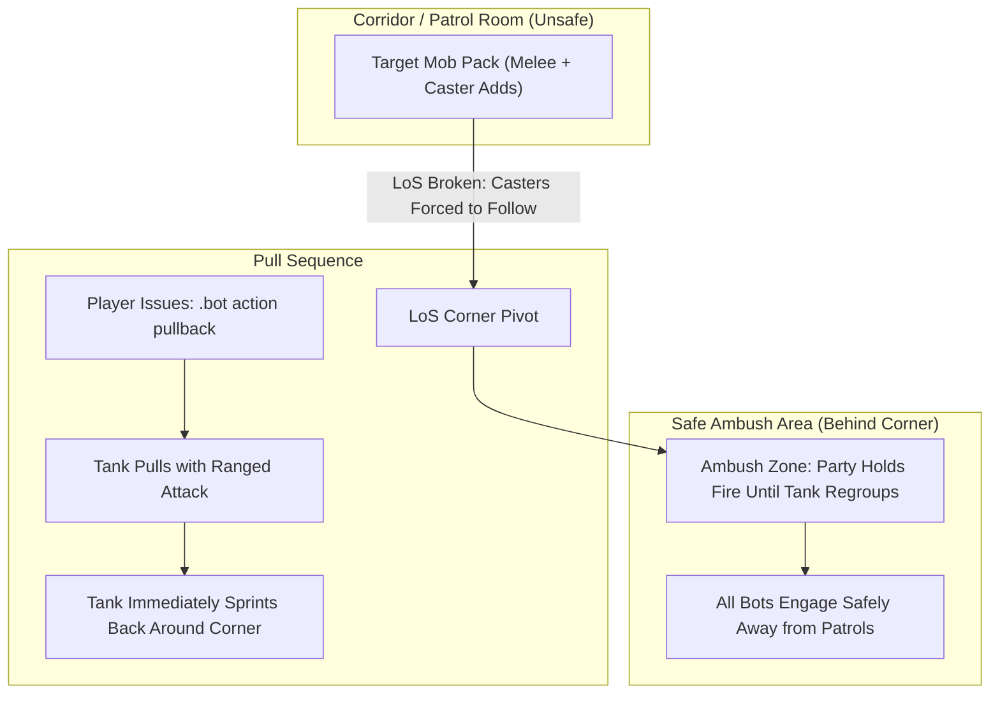

# Dungeon & Raid Tactics Guide

Leading a companion bot party through dungeons and raids requires deliberate positioning, pull discipline, and crowd control. Dungeon enemies hit hard, patrol packs add unexpectedly, and spellcasters stand at range. This guide explains how bot combat and movement mechanics work inside instances and how to lead your group safely.

For creature IDs, boss kill orders, and pooled rares for individual Turtle WoW 5-man dungeons, see the [Turtle 5-Man Dungeon Reference](dungeon-reference.md).

## The Five Golden Rules of Bot Dungeoneering

1. **Pull to Line-of-Sight Corners, Don't Charge:** Use [`.bot action pullback`](commands/party-actions.md#bot-action-pullback) so the tank pulls from range and runs back around a corner to your party. Never fight in open hallways where patrols roam.
2. **Toggle AoE Off on Crowd Control Packs:** Before pulling packs where you plan to use *Polymorph*, *Sap*, or traps, run [`.bot action aoe off`](commands/party-actions.md#bot-action-aoe). This stops damage-over-time spells and area attacks from breaking crowd control.
3. **Always Mark the Primary Target with Skull:** Issue [`.bot action focus skull`](commands/party-actions.md#bot-action-focus-skull). DPS bots treat the Skull mark as their kill priority while respecting CC and peel rules.
4. **Give the Tank Two Seconds:** Tanks apply threat abilities like *Sunder Armor* or *Torment* based on lowest personal threat. Give them 2–3 seconds to establish initial aggro before opening burst damage.
5. **Keep Summon Ready:** If a bot gets stuck on complex instance terrain, stairs, or elevators, use [`.bot summon <Name>`](commands/roster-and-hiring.md#bot-summon) to snap them to your location out of combat.

## Pulling Mechanics & Line-of-Sight (LoS)

Corridors are hazardous in dungeons like Deadmines, Scarlet Monastery, and Stratholme. Casters stand at 30 yards casting fireballs while patrols flank your healer.

### The Pullback Maneuver

When you target an enemy and issue [`.bot action pullback`](commands/party-actions.md#bot-action-pullback):

1. **Puller Selection:** The server picks the puller by precedence: your targeted bot, else any bot designated with the tank role, else a native tank-spec bot.
2. **Ranged Strike:** The tank uses its class pull action (ranged weapon shot, throw, *Judgement*, *Faerie Fire*, *Serpent Sting*, or *Lightning Bolt*). If no ranged attack is available, it closes in for a body pull.
3. **Corner Sprint:** After applying initial threat, the tank immediately sprints back to your party's current location. Non-tank bots hold fire until the tank reaches the regroup anchor, drawing the pack around the corner into your ambush.
4. **Hold Release:** The tank holds the regroup anchor only for the fight that the pull brought in. When the mobs are dead, the hold releases and the tank resumes normal follow formation. Any manual movement order ([`.bot action stay`](commands/party-actions.md#bot-action-stay) or [`.bot action follow`](commands/party-actions.md#bot-action-follow)) overrides this hold.
5. **Failed Pull Cleanup:** If a pull draws no aggro because the shot is blocked, the mob evades, or nothing arrives within 15 seconds, the tank drops the target, leaves combat, and rejoins the party. DPS bots are released immediately rather than waiting.

## Crowd Control Protocol

Crowd control is essential for managing multi-mob packs in level 40+ dungeons.

### Raid Target Icon Assignments

Every bot starts with **Moon** as its default CC mark. The table below represents the recommended convention:

| Raid Icon | Primary Class & Ability | Valid Targets | Notes |
| :---: | :--- | :--- | :--- |
| **Moon** | **Mage** (*Polymorph*) / **Rogue** (*Sap*) | Beasts, Humanoids (Sap: humanoids only) | Rogues stealth and Sap out of combat before the pull. |
| **Star** | **Priest** (*Shackle Undead*) / **Paladin** (*Turn Undead*) | Undead only | Essential in Stratholme, Scholomance, and Shadowfang Keep. |
| **Diamond** | **Warlock** (*Banish* / *Fear*) | Demons, Elementals (Banish) | Banish immunizes target; Fear only on assigned mark. |
| **Triangle** | **Hunter** (*Freezing Trap* or *Scare Beast*) / **Druid** (*Hibernate* / *Roots*) | Beasts, Dragonkin | Hunter Freezing Trap or Scare Beast; Druid Hibernate (beasts, dragonkin) or Roots (outdoors only). |

### Issuing CC In-Game

- Target the enemy mob and run [`.bot action cc <mark>`](commands/party-actions.md#bot-action-cc).
- **Exclusive Mark Ownership:** Each mark is assigned to exactly one bot. Reassigning a mark moves ownership.
- **Rogue Sap Before Pull:** Out of combat, a rogue stealths and Saps the humanoid marked with its CC icon. Mark the target first, wait for the Sap, then pull.
- **Dungeon 5-Man Rule:** Inside non-raid dungeons, bots CC only their explicitly assigned mark. They never CC random targets unless opt-in auto-CC is enabled ([`.bot action auto cc`](commands/party-actions.md#bot-action-auto-cc)).
- **Protection for Held Marks:** Party bots and pets strictly avoid attacking crowd-controlled targets until all other active threats are dead. Marked mobs are killed last.
- **Area Spell Discipline:** Area spells (*Blizzard*, *Rain of Fire*, *Multi-Shot*, *Frost Nova*) automatically check blast radii and will not fire if their radius touches a crowd-controlled enemy.
- **Healer Peel Taunt Exception:** If a crowd-controlled mob breaks free or an un-CC'd mark attacks a healer, the tank will taunt it to save the healer without breaking CC rules.

Detailed interrupt and pet discipline mechanics

When you order [`.bot action interrupt`](commands/party-actions.md#bot-action-interrupt) or let bots counter enemy casts, the AI probes for ready interrupt abilities across party members:
- Rogue: *Kick*
- Warrior: *Pummel* (Berserker) or *Shield Bash* (Battle/Defensive with shield)
- Shaman: *Earth Shock*
- Mage: *Counterspell*
- Priest: *Silence* (Shadow)
- Warlock: *Spell Lock* (Felhunter pet) or *Death Coil*
- Paladin: *Hammer of Justice* (stun) or *Repentance*
- Druid: *Bash* (Bear)

If the assigned bot is in range, it casts immediately; otherwise, it closes distance first.

Pets belonging to Hunter and Warlock bots strictly respect breakable CC (*Polymorph*, frozen effects, *Sap*, *Gouge*, *Shackle Undead*) unless explicitly directed to the Skull-marked target. *Seduce* is not an autonomous bot CC executor; however, a seduced mob is treated as crowd-controlled and protected from area-of-effect abilities.

## Wipe Recovery & Instance Navigation

If your group wipes, follow this recovery checklist:

### Releasing Spirit & Corpse Runs

1. When dead, whisper your bots `/w <BotName> release` (or type `.bot command <Name> release`). See [Whisper Commands](commands/whispers.md#w--release).
2. Once in ghost form at the graveyard, issue `/w <BotName> corpse run`.
3. Ghost bots path back to the instance entrance and zone inside.
4. If a bot gets stuck outside the entrance, zone inside yourself and use [`.bot summon <Name>`](commands/roster-and-hiring.md#bot-summon) at the instance portal.

### Healers and Casters Closing Range

Inside an instance, a healer or caster that has line of sight to its target but stands out of range walks the navmesh path forward and stops at the first point within casting distance. Out of combat, a healer only walks to a party member who is injured (below [`AiPlayerbot.AlmostFullHealth`](../server/settings/combat.md#aiplayerbotalmostfullhealth)). In combat, healers stay close to the tank ([shared positioning rules](../classes/overview.md#healer-positioning)).

### Stepping Down Off Dais and Ledges

Dungeon navmeshes sometimes contain raised platforms or dais platforms (such as in Uldaman's Hall of the Keepers) that are not linked by stairs to the surrounding floor. Inside dungeons and raids, a bot that lands on an isolated dais steps off the edge: it searches for walkable floor 2–8 yards lower within 8 yards forward. The bot runs over the edge and drops down safely. It will not drop while actively taking melee hits. If no safe landing floor exists, use [`.bot summon <Name>`](commands/roster-and-hiring.md#bot-summon) out of combat.

### Followers That Stand Still

When following out of combat inside instances, navmesh paths can occasionally stop responding if a bot is stuck on complex geometry. A bot that is more than 3 yards beyond its follow distance and has remained stationary for 2 seconds automatically attempts a local rescue walk to rejoin the leader.

### Running Ahead Past Packs

Bots that are far behind follow the navmesh route to you. If your party skipped a pack in a narrow hallway, trailing bots can aggro it. When [`AiPlayerbot.DungeonFollowHoldBeforePacks`](../server/settings/party.md#aiplayerbotdungeonfollowholdbeforepacks) is enabled, any follower more than 30 yards behind stops outside the aggro range of unpulled packs and whispers `Pack in the way: <name>`. You can then clear the pack or walk back within 25 yards to resume follow.

### Elevators and Ledges

Bots do not jump autonomously inside dungeons or raids (the chase jump, follow jump, and RPG jump actions are disabled to prevent bots from landing on unpathable ledges). Wait for bots at the bottom of elevators or after ledge drops, then click **Summon** in `/tbm` or run [`.bot summon <Name>`](commands/roster-and-hiring.md#bot-summon) to regroup before engaging the next pack.

## Dungeon Loot & Supplies

### Loot Rolling Rules

- Bots participate in standard party loot rolls (`Need`, `Greed`, `Pass`).
- **Never Need Against a Player:** Genuine upgrades are Needed regardless of settings; both cases still wait for humans and step down to Greed/Pass if a human Needs. Bots hold their vote to give human players the full window, then vote once all humans have voted.
- **Empty Slot Filler:** When [`AiPlayerbot.RollBadItemsWithPlayer`](../server/settings/party.md#aiplayerbotrollbaditemswithplayer) is enabled, bots also roll Need on items that fill empty gear slots.
- **Whisper Overrides:** You can instruct a bot directly: whisper `/w <BotName> keep need [item]` before a roll or `/w <BotName> roll need [item]` while the roll is open. Whisper `/w <BotName> roll feedback` to have the bot report when it steps down. See [Whisper Commands](commands/whispers.md#inventory-items--banking).

### Reagents and Food Sharing

- Open trade with Mage or Warlock bots out of combat (`/w <Name> trade`). They automatically place conjured food, water, or healthstones into the trade window.
- To make an owned bot equip an item from its bags, whisper `/w <Name> equip [Item Link]`. See [Whisper Commands](commands/whispers.md#inventory-items--banking).

## Raid Tactics & Boss Mechanics

Entering a raid map automatically activates the dungeon transition engine, enabling raid strategies for Molten Core, Onyxia's Lair, Blackwing Lair, Naxxramas, Zul'Gurub, Ruins of Ahn'Qiraj, and Temple of Ahn'Qiraj.

The `dungeon` strategy detects the current map after walking or teleporting in,
including a summon straight into combat. Loading an older combat/non-combat
strategy snapshot retains this detector when its saved list omits it; an
explicit saved `-dungeon` still wins. Existing sessions missing it need a
strategy reload/relog or `.bot command all all +dungeon`. Detection runs on the
normal trigger interval after world insertion and teleport completion. This
does not automatically enable every optional boss strategy or guarantee that
an avoidance action succeeds.

### Universal Raid Reactions

- **Bomb Runout:** Carriers of *Living Bomb* (Baron Geddon), *Burning Adrenaline* (Vaelastrasz), *Mutating Injection* (Grobbulus), or *Detonate Mana* (Kel'Thuzad) immediately run clear of the raid group ([`AiPlayerbot.BombRunoutDistance`](../server/settings/dungeons-raids.md#aiplayerbotbombrunoutdistance)). Ranged Grobbulus carriers run behind the boss.
- **Mutating Injection Cleansing Policy:** Healer disease cleansing spells intentionally skip Mutating Injection. Removing the debuff early drops a lethal poison cloud inside the raid; the carrier must run out and let the debuff expire harmlessly.
- **Living Bomb Spacing:** During the Baron Geddon fight, any bot standing within 10 yards of a Living Bomb carrier steps away to avoid the explosion.
- **Hazard Evasion:** Bots proactively step out of damaging ground effects, void zones, and trigger traps ([`AiPlayerbot.HazardEvasionDistance`](../server/settings/dungeons-raids.md#aiplayerbothazardevasiondistance)).
- **Living Poison Avoidance:** In Naxxramas, bots detect drifting Living Poison, step out inside 10 yd, and keep about 11 yd clear ([`AiPlayerbot.AvoidCreatureAuras`](../server/settings/dungeons-raids.md#aiplayerbotavoidcreatureauras)). Tanks step out as well because the explosion is fatal.
- **Dragon Positioning:** Non-tanks automatically flank dragons to avoid breath and tail sweep cones. Tanks can be ordered to turn dragons with [`.bot action raid tankface`](commands/party-actions.md#bot-action-raid-tankface).
- **Tank Assignment & Raid Assistant:** Main tanks and assist tanks coordinate boss and add assignments. Promoting an assist tank to **Raid Assistant** in the party frames assigns them secondary tank roles (such as holding Razorgore or Golemagg adds).
- **Ranged Spread:** Stacked ranged spellcasters step out to 10-12 yd to minimize chain damage. Wider spacing is opt-in only via `.bot behavior party spread on` (5 yd ranged / 2 yd melee defaults, tanks excluded).
- **Dispel Coordination:** Decursers and dispellers coordinate target claims to avoid casting multiple dispels on the same friendly target simultaneously.
- **Protection Potions:** Bots level 48+ automatically drink Greater Protection Potions on relevant bosses if carried in bags: Fire for Magmadar, Geddon, Golemagg, Ragnaros, Onyxia, Razorgore, and Vaelastrasz; Shadow for Lucifron, Gehennas, and Nefarian; Nature for Princess Huhuran and Viscidus.

### Specific Encounter Tactics

- **Molten Core:**
  - Douse runes using [`.bot action raid douse`](commands/party-actions.md#bot-action-raid-douse). During Baron Geddon, bots run out during *Inferno*.
  - *Garr & Shazzrah:* Garr holds DPS AoE off (Firesworn die single-target); Shazzrah pushes ranged out to 26 yd.
  - *Golemagg:* Melee back off at 20 Magma Splash stacks; assist tanks hold Core Ragers at fixed camps (30 yd Trust separation); healers work the camp midpoint; DPS leave ragers alone while Golemagg lives (burn below 10%).
- **Onyxia:** In Phase 2, bots switch to ranged attacks and spread out. Bots take cover in safe zones during *Deep Breath*. With [`AiPlayerbot.OnyxiaWhelpsAndEggs`](../server/settings/dungeons-raids.md#aiplayerbotonyxiawhelpsandeggs) enabled, ranged DPS clear hatched whelps while avoiding unbroken egg clusters.
- **Blackwing Lair:**
  - *Razorgore:* Bots assist the orb controller and intercept add waves without attacking the controller. Non-victims clear the frontal cone; assist tank holds the boss while eggs live.
  - *Vaelastrasz:* Tanks face away; Burning Adrenaline carriers flee from clean bots (tank holds).
  - *Broodlord & Nefarian:* Tanks face away; rogues disarm suppression devices in both combat and non-combat states. Mages use *Ice Block* to survive Nefarian Wild Magic. Bots whisper a warning if they lack the Onyxia Scale Cloak for Shadow Flame.
  - *Chromaggus:* Bots carrying Hourglass Sand (item 19183) use it to cleanse Bronze Affliction; bots step out of breath cones.
- **Naxxramas:**
  - *Anub'Rekhan:* Non-tanks collapse to the room center during Locust Swarm; non-tanks burn Crypt Guards first when no swarm is up; tank kite ring needs live waypoints (no bot kite tactic).
  - *Gluth:* Tanks rotate taunts at 5 Mortal Wound stacks; non-tank DPS execute sub-10% chow while tanks hold Gluth (kiting/slowing is the player's job; no bot kite ring).
  - *Thaddius:* Bots match Polarity Shift directions, shifting negative charges left and positive charges right.
  - *Loatheb:* Bots kill the spore underfoot for the Fungal Bloom buff and otherwise stay on Loatheb; no Necrotic Aura heal-timing exists in vanilla.
  - *Four Horsemen:* Mark carriers with 3+ stacks rotate clockwise to the next corner.
  - *Sapphiron:* Bots hide behind iceblocked players during the air phase and step out of blizzards.
  - *Heigan:* The group dances floor sections 0-1-2-3-2-1 during Plague Cloud.
  - *Kel'Thuzad:* Bots flee Shadow Fissures immediately; Frost Blast handling is not scripted beyond the shared bomb runout for Detonate Mana carriers.
- **Ahn'Qiraj (AQ20/AQ40):** Designated runners activate crystals while *Strength of Ossirian* is active. Kiting Ossirian remains the player's responsibility.
- **Paladin Aura Auto-Swap:** Paladins in raids automatically swap to *Fire Resistance Aura* or *Shadow Resistance Aura* on applicable bosses.

## Custom Turtle Raids

When [`AiPlayerbot.EnableCustomRaidTactics`](../server/settings/dungeons-raids.md#aiplayerbotenablecustomraidtactics) is enabled, the raid engine handles custom Turtle WoW raid encounters:

- **Emerald Sanctum (Solnius):** Tanks keep the dragon facing away to avoid Acid Breath. Emerald Rot carriers run out via the shared bomb runout action. When Call of Nightmare triggers, DPS bots focus down incoming add waves.
- **Lower Karazhan (Araxxna & Moroes):** Araxxna's spiderling swarms trigger AoE cleave. Moroes' smoke bomb forces tanks and DPS to re-acquire their targets.
- **Karazhan Crypt:** Set [`.bot formation near`](commands/party-actions.md#bot-formation) before entering narrow tunnels to keep bots from clipping through walls. Levers and puzzle doors must be operated manually by the player.

### Huhuran backup tanks

The opt-in `huhuran tank` role keeps two or three configured tanks attacking the
engaged boss; handoffs use actual threat, never automatic taunts. Optional
`huhuran ranged` spacing helps non-soaking ranged/healers stay outside the close
group. It cannot replace 15 prepared nature-resistance soakers. See the
[assignment commands and limitations](local-companion-controls.md#huhuran-threat-tanks-and-ranged-spacing-opt-in).
