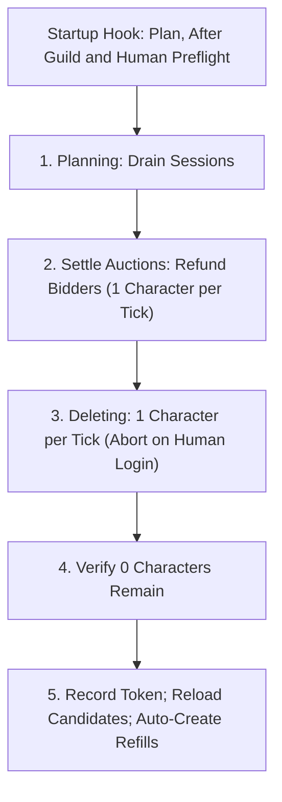

# Managing & Resetting the Bot Pool

Pool bots are autonomous characters that level, wander, run dungeons, and trade. Player characters and owned alts are never part of the pool. This page covers how the server tells them apart, how to adopt legacy bot accounts, and how to rebuild the pool.

For pool size and creation settings, see [World population settings](settings/world-population.md).

## The Managed Pool Registry

An account counts as a pool account **only** if it has a record in the registry table. The registry is the character-database table that tracks managed pool accounts.

- **Prefix is not ownership.** [`AiPlayerbot.RandomBotAccountPrefix`](settings/world-population.md#aiplayerbotrandombotaccountprefix) names new bot accounts and finds legacy candidates. A matching prefix alone never authorizes deletion.
- **Validation before deletion.** Every registered account is checked against the login database (account ID and username) before anything destructive runs. A renamed or missing account fails validation instead of being deleted.
- **Player accounts stay out.** Personal accounts and owned alts are never registered, even if a name looks like a bot prefix.

## Adopting Legacy Bot Accounts

Servers upgraded from older systems may have bot accounts that were never registered. At startup the server logs an error for accounts that match the bot prefix but are not registered. They are ignored by the pool until adopted.

Adoption runs **only at the server console**:

1. Preview candidates with [`bot pool adopt preview`](admin-commands.md#bot-pool-adopt-preview). The output lists matching accounts and gives a confirmation token, valid for 5 minutes.
2. Review the list. The token is derived from the exact previewed set: any change before confirming invalidates it.
3. Confirm with [`bot pool adopt confirm <challenge>`](admin-commands.md#bot-pool-adopt-confirm).
4. Check enrollment with [`bot pool status`](admin-commands.md#bot-pool-status).

Confirming is idempotent: already-registered accounts are counted, not errored. Adoption only adds registry rows. It never deletes, renames, or modifies characters or accounts.

## Resetting the Managed Bot Pool

Use a reset when fresh-character rules change (level seeding, starter gear, talent or profession seeding) and you want every pool character regenerated. The reset deletes all managed characters but keeps the login accounts, so auto-create refills the pool with new characters.

Resetting needs `AiPlayerbot.RandomBotAutoCreate = 1`. Without auto-create the reset is refused, so the world is never left empty.

The reset runs **only during world startup**, one step per world tick:

- `.reload config` never starts a reset.
- No live in-game reset command exists. A running world is never mutated.

### Reset Modes

Set [`AiPlayerbot.RandomBotPoolReset`](settings/world-population.md#aiplayerbotrandombotpoolreset) in `aiplayerbot.conf`:

| Setting Value | Behavior |
| :--- | :--- |
| `off` | Never reset. Default and recommended for live servers. |
| `once:<token>` | Reset on next startup only, if `<token>` differs from the last completed token. The token is 1-128 printable, non-space characters. |
| `always` | Reset on every startup. Development only: wipes progression on each restart. Never overwrites a stored one-shot token. |
| *(anything else)* | Logs an error and aborts the reset. `once:` with no token counts as invalid. |

### Step-by-Step Reset Workflow

1. **Back up the character database.**
2. Start the server with `AiPlayerbot.RandomBotPoolReset = off`.
3. Check the pool with [`bot pool status`](admin-commands.md#bot-pool-status) (server console, or in-game as a GameMaster).
4. If upgrading an old database, adopt legacy accounts first ([preview](admin-commands.md#bot-pool-adopt-preview), then [confirm](admin-commands.md#bot-pool-adopt-confirm), both console only).
5. Confirm managed accounts with [`bot pool accounts`](admin-commands.md#bot-pool-accounts) (console only).
6. Stop `mangosd` cleanly.
7. Edit `aiplayerbot.conf`:
   ```ini
   AiPlayerbot.RandomBotPoolReset = once:fresh-build-01
   AiPlayerbot.RandomBotAutoCreate = 1
   ```
8. Start the server and watch `Server.log` for reset progress.
9. Verify the rebuild with [`bot pool status`](admin-commands.md#bot-pool-status). Auto-create refills the pool toward the target between `MinRandomBots` and `MaxRandomBots`.
10. Leave the token in place. Since it matches the completed generation, it will not run again. If the server stops mid-reset, the unfinished generation is not recorded and the reset resumes on next startup.

### What a Reset Intentionally Deletes

- Character progress for pool bots: levels, equipment, inventory, bank, quests, professions (deleted through core character deletion).
- Module rows tied to those characters: AI state, custom strategies, ownership, hire ledger, armory snapshots, hire-unlock kills, transmogs, unclaimed guild claims, guild orders.
- Hired mercenaries riding pool accounts: their hire state is forgotten and ledger rows go with the character.
- Guilds made up only of pool bots, as a side effect of deleting every member.
- Active auction listings posted by pool bots, after refunding bidders by mail. Hardcore bidders follow core rules and are not refunded. If a bidder cannot be resolved, the reset stops before deleting the listing.

What survives or is guaranteed:

- **Login accounts are never deleted.** The server keeps them. Auto-create makes level 1 characters on them, and each fresh bot is level-seeded on first login to a random level between `AiPlayerbot.RandomBotStartLevelMin` and `RandomBotStartLevelMax` (defaults `5` and `60`).
- **Claimed bots survive.** A pool bot that accepted your guild invite (claimed) is excluded from the deletion set.
- **Pinned names do not resurrect.** Pinned bots on managed accounts are deleted with the pool. Pinned resolution looks names up, so a deleted pinned name does not come back by itself; auto-create picks new random names.
- **An empty pool is a verified no-op.** The generation is still recorded, so a token cannot silently wipe a pool that auto-create builds afterwards.

### Safety Guarantees & Multi-Phase Execution

The startup reset runs in safety phases:



<details>
<summary>Detailed safety invariants and auction settlement</summary>

- **Session draining.** Pool bot sessions are disconnected before deletion starts. If a bot session fails to disconnect within 120 seconds, the reset fails without deleting characters.
- **Human session protection.** If a player logs into a pool character, the reset aborts before deleting that character: a preflight abort happens before anything is deleted, and a mid-reset login stops the reset.
- **Auction refunds first.** Each listing posted by a pool bot is settled one character per world tick. Active bidders get full refunds by mail before any character is removed. If a bidder cannot be resolved, the reset stops and leaves the listing untouched.
- **Guild protection.** Before anything is deleted, the reset checks guilds led by pool characters. If a pool-led guild has even one member outside the managed pool, the reset aborts and logs the guild name, leader, and offending member.
- **Token recorded last.** The new token is stored only after all managed characters are deleted and verified. If the server stops mid-reset, the next startup resumes it.
- **Maintenance lock.** While a reset is running, failed, or the registry cannot be validated, the pool stays unavailable: auto-creation, pool logins, pinned resolution, hiring, and battleground bot selection stay locked until it resolves.

</details>
